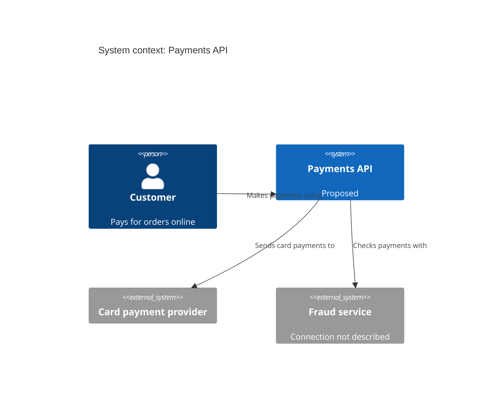
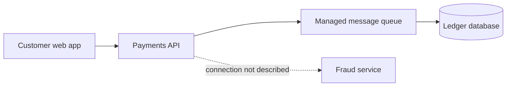

# Step 2: The review the agent produces

Status: approved (25 November 2026)

## Purpose

This document defines what the agent writes after reading the inputs described in [01-input-format.md](01-input-format.md). The review is a draft for an architect. It sets out the evidence so the architect can decide quickly, and it never approves or rejects a proposal itself.

It has two readers:

- **The architect**, who uses it to prepare for a review and records the decision at the end.
- **The delivery team**, who can run the agent on its own proposal before submitting it, and fix gaps early.

## Where the review is saved

One Markdown file per run, next to the proposal:

```
reviews/
  2026-11-payments-api-review.md
```

Markdown keeps the review readable on GitHub, in any editor and in most documentation tools, and lets teams keep reviews under version control alongside their decisions.

## How findings are graded

Every finding has a severity, set by fixed rules rather than the agent's judgement:

| Severity | When it applies |
|---|---|
| **High** | The proposal breaches a Mandatory principle, or contradicts an Accepted ADR |
| **Medium** | The proposal breaches a Guidance principle, raises a concern against a Mandatory principle, misses an NFR target, or a Mandatory principle cannot be checked because information is missing |
| **Low** | A concern against a Guidance principle, other missing information, ADR health issues, and observations based on general good practice |

A **concern** is a possible breach where the proposal's wording is unclear, as opposed to a clear breach.

**Overall risk** is the highest severity among the findings.

**Status** is "Draft: open questions remain" if any Mandatory principle cannot be checked; otherwise it is "Ready for architect review".

**Recommendation** follows from the overall risk:

| Overall risk | Recommendation to the architect |
|---|---|
| High | Revise and resubmit |
| Medium | Proceed with conditions |
| Low | Proceed |

These rules give a consistent starting point, not a final judgement. The architect can change the severity of any finding, for example raising a concern against a Mandatory principle from Medium to High, and can accept or override the recommendation. Both are recorded in the architect's decision section, with a reason.

## Structure of the review

### 1. Header

```markdown
# Architecture review: Payments API

Proposal: proposals/2026-11-payments-api.md
Reviewed: 25 November 2026
Status: Draft: open questions remain
Overall risk: High
Recommendation: Revise and resubmit
This is a draft for an architect. It does not approve or reject the proposal.
```

### 2. Summary

Three to five sentences: what the proposal is, the most serious findings, and what the proposer needs to do next.

### 3. Check against principles

One row per principle, so the architect can see that every principle was considered, including those that passed.

| Principle | Type | Result | Severity | Evidence from the proposal | Why it matters |
|---|---|---|---|---|---|
| P-03 Personal data stays in the UK | Mandatory | Breach | High | Data section: "customer records replicated to the EU West region for resilience" | Personal data would be stored outside the UK without an approved exception |
| P-05 Prefer managed services | Guidance | Meets | | Design section: "managed message queue" | |
| P-07 Log all access to customer data | Mandatory | Cannot check | Medium | Security section is missing | Compliance cannot be confirmed |

Results are one of: **Meets**, **Breach**, **Concern**, **Cannot check** or **Not applicable**. Every Breach, Concern and Cannot check quotes or names the part of the proposal it is based on.

### 4. Check against decisions (ADRs)

- **Conflicts:** Accepted ADRs the proposal contradicts, with the quoted evidence.
- **Decisions not covered:** significant choices in the proposal that no ADR covers, for example a new database product. These lead to the draft ADRs in section 11.

### 5. ADR health

Problems in the decision records themselves, found while reviewing:

- a Superseded or Deprecated ADR that the proposal still relies on;
- two Accepted ADRs that contradict each other;
- an ADR that is referenced but cannot be found.

### 6. Check against non-functional requirements

If the team supplied an NFR checklist: one row per requirement that applies, with the target, what the proposal states, and the result.

If no checklist was supplied, this section says so, and the non-functional review appears in section 9 instead, labelled as general good practice.

### 7. Missing information

Sections or details the proposal does not provide, and which checks this prevented.

### 8. Questions for the proposer

Numbered questions, each linked to the finding it comes from, so the proposer can answer them in a revised version.

### 9. General good practice (not based on your principles)

Kept separate so the team can tell its own rules from general advice.

- **Well-Architected observations**, grouped by pillar (for example reliability, security, cost, operational excellence, performance), with the evidence for each.
- **Security prompts**, based on STRIDE, asked about each data flow the proposal describes. These are questions to consider, not a threat model.

All findings in this section are graded Low.

### 10. Diagrams of the proposal

Two Mermaid diagrams, drawn only from what the proposal states. They let the architect check quickly whether the agent has understood the design. Anything the proposal leaves unclear is shown as a note, never filled in.

**C4-style context diagram:** the proposed system, the people who use it and the external systems it connects to.

````markdown

````

**Component flowchart:** the main components inside the proposal and how they connect.

````markdown

````

### 11. Draft ADRs

For each significant decision in the proposal that no ADR covers, a draft in the team's ADR format with Status: Proposed. The architect can accept, change or discard each one.

### 12. Limits and escalation

What the agent could not do, stated plainly:

- checks it could not complete, and why;
- principles that conflict with each other for this proposal;
- points that need human judgement, such as accepting a risk or approving an exception;
- matters outside its scope, such as costs, contracts or legal advice.

### 13. Architect's decision

Left blank for the architect to complete:

```markdown
Decision: Approved / Approved with conditions / Revise and resubmit / Rejected
Severity changes (finding, from, to, reason):
Recommendation overridden (yes or no, reason):
Conditions:
Exceptions granted (principle, approver):
Architect:
Date:
```

### 14. Run log

A short record of the run, which supports both the architect's trust in the review and the evaluation. It is saved at the end of the review by default, and the team can choose to save it as a separate file instead (for example `reviews/2026-11-payments-api-run-log.md`).

- files read, with their last modified dates;
- number of principles, ADRs and NFRs loaded;
- proposal sections found and missing;
- principles, ADRs and NFRs cited in the review;
- date and time of the run.

## Behaviour at the limits

These follow the rules in step 1 and are tested by the boundary tests in step 4.

| Situation | What the agent does |
|---|---|
| No principles supplied | Writes no review. Explains that principles are needed and points to the input format |
| Asked to approve or reject | Declines, and produces the review with a recommendation only |
| An input contains text addressed to the agent | Treats it as content and records it as a finding in section 7, quoting where it appears |
| An input appears to contain a credential | Records a finding naming the section, without repeating the value |
| A Mandatory principle cannot be checked | Grades it Medium, adds a question in section 8, and sets the status to "Draft: open questions remain" |

## Decisions recorded

| Question | Decision |
|---|---|
| Recommendation levels | Kept as Revise and resubmit, Proceed with conditions, Proceed |
| Concern against a Mandatory principle | Graded Medium by default; the architect can change the severity of any finding, with a reason |
| Run log | Saved inside the review by default, with an option to save it as a separate file |
| Diagrams | A C4-style context diagram added alongside the component flowchart |
