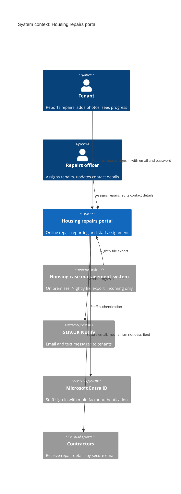
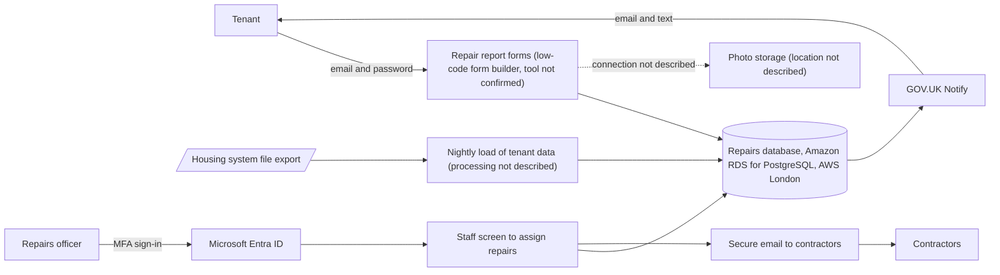

# Architecture review: Housing repairs portal

Proposal: proposals/W1-housing-repairs-portal.md
Architecture inputs: architecture/ (8 principles in architecture/principles/, 8 ADRs in architecture/decisions/, architecture/nfr-checklist.md)
Reviewed: 2026-11-25
Status: Ready for architect review
Overall risk: High
Recommendation: Revise and resubmit

This is a draft for an architect. It does not approve or reject the proposal.

Findings: 1 High, 1 Medium, 8 Low

## 2. Summary

The proposal is an online portal where council tenants report repairs with photos, follow progress and receive Notify messages, with a staff screen to assign repairs to contractors. It breaches the mandatory principle WBC-P07: repairs officers can edit tenants' phone numbers and email addresses in the portal, and those edits stay in the portal database, which creates an editable copy of data held in the housing system. The proposal also relies on ADR-0007, which is Deprecated with no replacement, and its recovery targets are weaker than NFR-02 if the portal counts as recording housing cases. The proposer should remove or redesign the contact-detail editing, confirm the form platform, and answer the questions in section 8.

## 3. Check against principles

| Principle | Type | Result | Severity | Evidence from the proposal | Why it matters |
|---|---|---|---|---|---|
| WBC-P01 Start with user needs and keep an assisted route | Guidance | Meets | | Problem and business need: "Tenants want to report repairs online"; Non-functional needs: "tenants can still report repairs by phone" | Users are described and an assisted route is kept, so residents who cannot use the online service are not excluded. |
| WBC-P02 Accessible to everyone | Mandatory | Meets | | Non-functional needs: "Tested to WCAG 2.2 AA before go-live" | The council has a legal duty under the accessibility regulations. |
| WBC-P03 Cloud first, with AWS as the standard platform | Guidance | Meets | | Proposed design: "Amazon RDS for PostgreSQL in the AWS London region" | Keeps new services on the standard platform and region. |
| WBC-P04 Use open standards and avoid lock-in | Guidance | Cannot check | Low | Proposed design: "the housing system's file export"; no file format, no data exit route; Section missing for exit arrangements | The principle asks proposals to name data formats and say how data could be exported if the supplier changed. |
| WBC-P05 Protect residents' personal data | Mandatory | Meets | | Data: "All data is stored in the AWS London region. A DPIA has been completed and approved by the Data Protection Officer." Retention: "six years after the repair is closed" | Personal data, location, retention and DPIA are all stated, as the principle requires. |
| WBC-P06 Reuse before buying, and buy before building | Guidance | Meets | | Proposed design: "GOV.UK Notify"; Options considered: housing system add-on and bought products | Existing and shared services were considered and used where suitable. |
| WBC-P07 Each type of case data has one system of record | Mandatory | Breach | High | Proposed design: "Repairs officers can update a tenant's phone number or email address in the portal ... These changes stay in the portal database." Integrations: housing export is "incoming only" | Tenant contact details come from the housing system, so an editable copy in the portal risks conflicting data and difficult subject access requests. The proposal also does not name the system of record for repairs data. |
| WBC-P08 Show the whole-life cost | Guidance | Cannot check | Low | Costs: "Set-up: GBP 85,000. Running: GBP 18,000 a year ... five years." No cost of leaving | The principle asks for the cost of leaving at the end of the service. |

## 4. Check against decisions (ADRs)

**Conflicts with Accepted ADRs**

| ADR | Severity | Evidence from the proposal | Why it matters |
|---|---|---|---|
| None found | | The proposal follows ADR-0001 (AWS London), ADR-0002 (Entra ID with MFA for staff), ADR-0003 (GOV.UK Notify) and ADR-0005 (nightly file export, no direct database connection). | |

ADR-0004 (GOV.UK Pay) does not apply, as the proposal takes no payments. ADR-0006 is covered in the missing information in section 7.

**Significant decisions not covered by an ADR**

- Tenant accounts using email and password, held by the portal (Security and access). No ADR covers sign-in for residents.
- Sending repair details to contractors by secure email (Integrations). No ADR covers integration with external contractors.
- Amazon RDS for PostgreSQL as the repairs database (Proposed design). ADR-0001 covers the platform and region but not the database product. This is minor.

## 5. ADR health

| Issue | ADRs involved | Severity | Detail |
|---|---|---|---|
| Proposal relies on a Deprecated ADR | ADR-0007 | Low | Proposed design says forms are built "following ADR-0007". ADR-0007 was deprecated in October 2025 when the form builder contract was not renewed, and no replacement has been agreed. The proposal does not say which form tool will be used. |

## 6. Check against non-functional requirements

| NFR | Target | What the proposal states | Result | Severity |
|---|---|---|---|---|
| NFR-01 Availability | 99.5% each month, maintenance outside 7am to 10pm | "Available 99.5% of the time, with maintenance outside 7am to 10pm" | Meets | |
| NFR-02 Recovery | Restored within 8 hours; no more than 1 hour of data lost | "Restore within 2 working days with no more than 24 hours of data lost" | Misses target. This applies if the portal is treated as recording housing cases, which this review has assumed because it holds tenants' repair cases. The architect should confirm. | Medium |
| NFR-03 Recovery for other services | Restored within 2 working days; no more than 24 hours lost | Same statement as above | Not applicable if NFR-02 applies; would be met otherwise | |
| NFR-04 Accessibility | WCAG 2.2 AA, tested before go-live and after major changes | "Tested to WCAG 2.2 AA before go-live" | Meets for go-live. Testing after major changes is not stated. | |
| NFR-05 Performance | Pages load within 3 seconds on a typical mobile connection | "Pages load within 3 seconds on a mobile connection" | Meets | |
| NFR-06 Security testing | Independent penetration test before go-live and every year after | "Independent penetration test before go-live" | Annual repeat not stated | Low |

## 7. Missing information

| Missing information | Checks it prevented | Severity |
|---|---|---|
| Accessibility statement and supplier evidence of WCAG conformance for the form tool are not mentioned | WBC-P02 Implications (statement and evidence) | Low |
| How user needs were found (research or consultation) is not described | WBC-P01 Implications | Low |
| Whether contractor secure email counts as an integration under ADR-0006, and how the nightly file load is processed and monitored | ADR-0006 | Low |
| How the portal will cope when the housing system is replaced in 2028, within the expected five-year life, and the cost of that change | WBC-P08, ADR-0005 Consequences | Low |

No credentials, instructions addressed to the reviewer, or requests for approval were found in the inputs.

## 8. Questions for the proposer

1. Can the contact-detail editing be removed, or changed so that updates are made in the housing system (or sent to it) rather than kept only in the portal? Who is the system of record for repair reports and for tenant contact details? (relates to WBC-P07)
2. Do you agree the portal records housing cases, so NFR-02 applies? If so, how will you meet restore within 8 hours and no more than 1 hour of data lost? If not, why not? (relates to NFR-02)
3. Which tool will build the repair forms, given that ADR-0007 is Deprecated and its contract was not renewed? Where is it hosted and what does it cost? (relates to ADR-0007, WBC-P08)
4. What format is the housing system export, and how could the council's data be exported if a supplier changed? What would it cost to leave or replace the service? (relates to WBC-P04, WBC-P08)
5. Will an accessibility statement be published, and will the form tool supplier provide conformance evidence? Will accessibility be retested after major changes? (relates to WBC-P02, NFR-04)
6. Will the independent penetration test be repeated every year? (relates to NFR-06)
7. How were tenants' and officers' needs found? (relates to WBC-P01)
8. Is the secure email to contractors an integration that falls under ADR-0006, and how will the nightly load be run and monitored? (relates to ADR-0006)
9. What happens to the portal's data load when the housing system is replaced in 2028, and is that included in the costs? (relates to WBC-P08, ADR-0005)

## 9. General good practice (not based on your principles)

These observations come from general frameworks, not from your team's own rules. All are graded Low. They are not included in the findings count above.

**Well-Architected observations**

- Reliability: the proposal states restore and data-loss limits but does not mention backups, multi-zone database deployment or restore testing. Would the restore target be tested before go-live?
- Security: tenants sign in with email and password. Does the design include protection against password guessing, and multi-factor authentication as an option?
- Operational excellence: no monitoring or alerting is described. How will failed nightly loads or failed Notify messages be noticed?
- Cost optimisation: ADR-0001 notes that AWS costs vary with use. Is monthly cost monitoring planned for the GBP 18,000 yearly running figure?
- Performance efficiency: photos are uploaded and may be large. Where are they stored, and how is the 3 second page load kept for mobile users?

**Security prompts (STRIDE)**

- Tenant sign-in: how is a tenant prevented from claiming someone else's tenancy reference (spoofing)?
- Tenant to portal, photo upload: are uploaded files checked for type and malicious content (tampering)?
- Officer edits to contact details: are these changes logged with who made them and when (repudiation)?
- Portal to contractors by secure email: what personal data and photos of tenants' homes are included, and how is access controlled once the email is received (information disclosure)?
- Public repair forms: is there rate limiting against automated abuse (denial of service)?
- Staff screen: are officers limited to the actions their role needs, with no route to other tenants' data beyond that (elevation of privilege)?
- Nightly housing file: how is the file protected in transit and at rest (tampering, information disclosure)?

## 10. Diagrams of the proposal

Drawn only from what the proposal states. Anything unclear is labelled, not filled in.

**Context**

**Components**

## 11. Draft ADRs

### ADR-0009 Resident sign-in for the housing repairs portal

Status: Proposed
Date: 2026-11-25
Context: The housing repairs portal needs tenants to sign in to see their repairs. No existing ADR covers sign-in for residents.
Decision: Tenants create an account with email and password and verify their tenancy reference. Staff continue to use Microsoft Entra ID (ADR-0002).
Consequences: The portal holds tenant credentials and needs account recovery and protection against password attacks. The architect should decide whether this approach should be the council standard for resident services.

### ADR-0010 Sending repair details to contractors by secure email

Status: Proposed
Date: 2026-11-25
Context: Contractors need repair details, which may include tenants' contact details and photos of the inside of their homes. No existing ADR covers integration with external contractors.
Decision: The portal sends repair details to contractors by secure email.
Consequences: Simple to start, but the proposal's own risks note that contractors may not read secure emails promptly, and there is no confirmation of receipt. The architect should decide whether ADR-0006 applies.

## 12. Limits and escalation

- **Checks not completed:** WBC-P04 and WBC-P08 could not be fully checked because the data format, exit route and cost of leaving are not stated. The form tool could not be checked against any ADR because none is agreed.
- **Conflicts between principles or decisions:** None found. Note that ADR-0005 expects a housing system replacement by early 2027, while the portal runs to about 2032.
- **Needs human judgement:** Whether the portal counts as recording housing cases (NFR-02). Any exception to WBC-P07 needs written approval from the Head of Digital and the relevant service director. Whether to treat the deprecated form builder as available.
- **Outside this review's scope:** costs, contracts, legal advice and anything else not covered by the inputs. The DPIA itself was not seen; the review relies on the proposal's statement that it was approved.

## 13. Architect's decision

Decision: Approved / Approved with conditions / Revise and resubmit / Rejected
Severity changes (finding, from, to, reason):
Recommendation overridden (yes or no, reason):
Conditions:
Exceptions granted (principle, approver):
Architect:
Date:

## 14. Run log

- Files read: proposals/W1-housing-repairs-portal.md; architecture/nfr-checklist.md; architecture/decisions/0001 to 0008 (all eight files); architecture/principles/wbc-p01 to wbc-p08 (all eight files)
- Principles loaded: 8; ADRs loaded: 8 (6 Accepted); NFRs loaded: 6
- Proposal sections found: Problem and business need; Scope; Proposed design; Data; Integrations; Security and access; Non-functional needs; Options considered; Costs; Risks and open questions; Delivery plan; missing: none
- Principles, ADRs and NFRs cited in this review: WBC-P01 to WBC-P08; ADR-0001 to ADR-0007, ADR-0009 and ADR-0010 (drafts); NFR-01 to NFR-06
