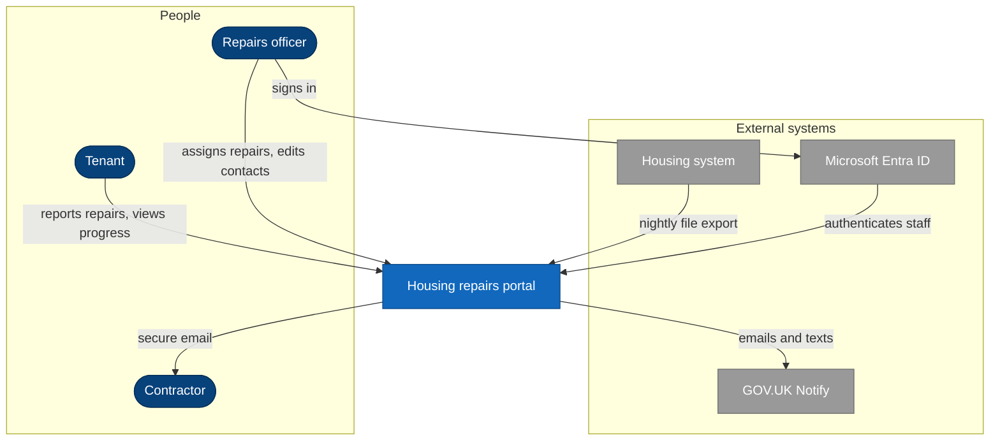
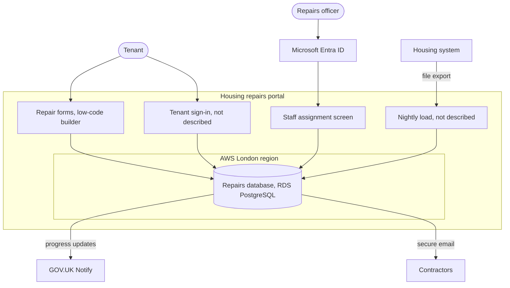

# Architecture review: Housing repairs portal

- **Proposal:** proposals/W1-housing-repairs-portal.md
- **Architecture inputs:** architecture/ (principles/, decisions/, nfr-checklist.md)
- **Reviewed:** 2026-11-25
- **Status:** Ready for architect review
- **Overall risk:** High
- **Recommendation:** Revise and resubmit
- **Findings:** 1 High, 1 Medium, 13 Low

This is a draft for an architect. It does not approve or reject the proposal.

## 2. Summary

The proposal is an online portal where council tenants report repairs with photos and follow progress, and where repairs officers assign work to contractors. It uses AWS London, GOV.UK Notify, Entra ID and the housing system's nightly file export, which fit the team's decisions. The most serious finding is that officers can edit tenant contact details in the portal and those edits stay there, which creates a second editable copy of housing data and breaches WBC-P07 (Mandatory). The proposal also states a recovery target weaker than NFR-02 and relies on a form builder whose ADR (ADR-0007) is Deprecated. The proposer should remove or justify the editable copy, confirm which recovery requirement applies, and say how forms will be built now that ADR-0007 is deprecated. The Low count includes three general good practice observations (section 9); the STRIDE prompts are questions and are not counted.

## 3. Check against principles

| Principle | Type | Result | Severity | Evidence from the proposal | Why it matters |
|---|---|---|---|---|---|
| WBC-P01 Start with user needs and keep an assisted route | Guidance | Concern | Low | Problem and business need: "Tenants want to report repairs online... Repairs officers want fewer calls." Non-functional needs: "tenants can still report repairs by phone." No description of how user needs were found. | The principle asks proposals to show how needs were found as well as offering an assisted route; the phone route is shown but the evidence of user research is not. |
| WBC-P02 Accessible to everyone | Mandatory | Meets | | Non-functional needs: "Tested to WCAG 2.2 AA before go-live" | The council has a legal duty under the public sector accessibility regulations. Publication of an accessibility statement is not mentioned (see section 7). |
| WBC-P03 Cloud first, with AWS as the standard platform | Guidance | Meets | | Proposed design: "A repairs database on Amazon RDS for PostgreSQL in the AWS London region." No new server room equipment is proposed. | Follows Cloud First and lets the council close its server room. |
| WBC-P04 Use open standards and avoid lock-in | Guidance | Cannot check | Low | Proposed design: "the housing system's file export" with no format named. Section missing: how data would be exported if the supplier or hosting changed. | The principle asks for named formats and interfaces and an exit route, which protects the council's ability to change supplier. |
| WBC-P05 Protect residents' personal data | Mandatory | Meets | | Data: "All data is stored in the AWS London region. A DPIA has been completed and approved by the Data Protection Officer." Retention: "six years after the repair is closed." | UK storage and a completed DPIA are the two requirements. Who can access the data is only partly described (see section 7). |
| WBC-P06 Reuse before buying, and buy before building | Guidance | Meets | | Proposed design: "through GOV.UK Notify." Options considered: extending the housing system and buying a repairs product were both assessed. No payments are taken, so GOV.UK Pay is not relevant. | Reuse of shared services saves public money. |
| WBC-P07 Each type of case data has one system of record | Mandatory | Breach | High | Proposed design: "Repairs officers can update a tenant's phone number or email address in the portal... These changes stay in the portal database." Also: the portal "loads tenant names, addresses, tenancy references and contact details from the housing system's file export." | Tenant contact details are held in the housing system and copied into the portal, where they can now be edited separately. Duplicate editable copies lead to errors and difficult subject access requests. Exception needs written approval from the Head of Digital and the relevant service director. |
| WBC-P08 Show the whole-life cost | Guidance | Concern | Low | Costs: "Set-up: GBP 85,000. Running: GBP 18,000 a year... for an expected five years." No cost of leaving is given. | The principle asks for set-up, running, contract length and the cost of leaving. The housing system is replaced in 2028, which may add rework cost to the five-year period. |

## 4. Check against decisions (ADRs)

**Conflicts with Accepted ADRs**

| ADR | Severity | Evidence from the proposal | Why it matters |
|---|---|---|---|
| None found | | | |

The proposal is consistent with these Accepted ADRs: ADR-0001 (AWS London), ADR-0002 (staff sign in through Entra ID with multi-factor authentication), ADR-0003 (Notify for emails and texts) and ADR-0005 (nightly file export, incoming only, no direct database connection). ADR-0004 (GOV.UK Pay) does not apply because no payments are taken. ADR-0006 requires new integrations to use API Gateway and Lambda; the proposal does not say how the nightly file is received and processed (see section 7).

**Significant decisions not covered by an ADR**

- Tenant sign-in with email and password, plus tenancy reference verification (Security and access). ADR-0002 covers staff only.
- Sending repair details to contractors by secure email (Integrations).
- Using Amazon RDS for PostgreSQL as the repairs database (Proposed design). ADR-0001 covers the region, not the database product.
- How resident forms are built now that ADR-0007 is Deprecated (Proposed design). No replacement decision exists.

## 5. ADR health

| Issue | ADRs involved | Severity | Detail |
|---|---|---|---|
| Proposal relies on a Deprecated ADR | ADR-0007 | Low | Proposed design: "built with the council's low-code form builder, following ADR-0007". ADR-0007 was deprecated in October 2025 when the form builder contract was not renewed, and no replacement has been agreed. The proposal is due live in June 2027. |

## 6. Check against non-functional requirements

| NFR | Target | What the proposal states | Result | Severity |
|---|---|---|---|---|
| NFR-01 Availability | 99.5% each month, planned maintenance outside 7am to 10pm | "Available 99.5% of the time, with maintenance outside 7am to 10pm." | Meets | |
| NFR-02 Recovery | Restored within 8 hours; no more than 1 hour of data lost | "Restore within 2 working days with no more than 24 hours of data lost." | Misses target | Medium |
| NFR-03 Recovery for other services | Restored within 2 working days; no more than 24 hours of data lost | Same statement as above. | Meets, but only if NFR-02 does not apply | |
| NFR-04 Accessibility | WCAG 2.2 AA, tested before go-live and after major changes | "Tested to WCAG 2.2 AA before go-live" | Partly stated: testing after major changes is not mentioned | Low |
| NFR-05 Performance | Pages load within 3 seconds on a typical mobile connection | "Pages load within 3 seconds on a mobile connection." | Meets | |
| NFR-06 Security testing | Independent penetration test before go-live, and every year after | "Independent penetration test before go-live." | Partly stated: yearly tests are not mentioned | Low |

NFR-02 applies to services that "record housing and council tax cases". I have treated the portal as covered because it holds repair records for council tenants against their tenancy references. The scope says the housing case management system itself is out of scope, so the architect should confirm this reading (see section 12).

## 7. Missing information

| Missing information | Checks it prevented | Severity |
|---|---|---|
| Whether an accessibility statement will be published, and whether the form tool supplier has given accessibility evidence | WBC-P02 implications | Low |
| Who can see tenant data and photos (staff roles, contractors) and how contractors store and delete what they receive by email | WBC-P05 implications (who can access) | Low |
| How the nightly file is received, processed and monitored | ADR-0006 (integrations on API Gateway and Lambda) | Low |
| How the nightly export and the portal will change when the housing system is replaced (ADR-0005: replacement chosen by early 2027, contract ends March 2028) | Delivery plan and five-year cost | Low |

Missing information for WBC-P01, WBC-P04, WBC-P08, NFR-04, NFR-06 and ADR-0007 is already recorded as findings in sections 3, 5 and 6, so it is not counted again here.

## 8. Questions for the proposer

1. Can the editable contact details be removed, for example by passing changes back to the housing team to update in the housing system? If not, who has agreed an exception? (relates to WBC-P07)
2. What happens to an officer's edit when the next nightly load runs: is it overwritten, kept or flagged? (relates to WBC-P07)
3. Does the portal need to meet the 8 hour and 1 hour recovery targets in NFR-02, or has it been agreed that NFR-03 applies? (relates to NFR-02)
4. How will the repair forms be built now that ADR-0007 is deprecated, who hosts the form tool, and where does it store submitted data? (relates to ADR-0007, WBC-P03, WBC-P05)
5. How were the needs of tenants and officers found, for example through interviews or call analysis? (relates to WBC-P01)
6. Which data formats are used for the nightly export and for the contractor emails, and how would the council get its data out if the hosting or support supplier changed? (relates to WBC-P04)
7. What is the cost of leaving at the end of the five years, and does the cost include changes needed when the housing system is replaced? (relates to WBC-P08)
8. Will an accessibility statement be published, and will accessibility be retested after major changes? (relates to WBC-P02, NFR-04)
9. Will the penetration test be repeated every year after go-live? (relates to NFR-06)
10. Who can see tenant data and photos, and does the DPIA cover the officer-edited contact details and photos of the inside of homes? (relates to WBC-P05)
11. How is the nightly file received and processed, and does this follow ADR-0006? (relates to ADR-0006)

## 9. General good practice (not based on your principles)

These observations come from general frameworks, not from your team's own rules. All are graded Low.

**Well-Architected observations**

- Reliability: the risks section says "Contractors may not read secure emails promptly", and the secure email is the only route to contractors. What acknowledgement or fallback is planned if a contractor does not respond?
- Security: Data says "Some photos may show the inside of tenants' homes", and these go to contractors by email. Is there any limit on what is sent and how long contractors keep it?
- Operational excellence: the nightly load is the only source of tenant details. How will a failed or incomplete load be noticed and fixed, given that no monitoring is described?

**Security prompts (STRIDE)**

- Tenant sign-up (email, password and tenancy reference): could someone guess tenancy references to create an account for another tenant (spoofing)? Is repeated guessing limited (denial of service)?
- Nightly file from the housing system: how is the file protected in transit and at rest, since it contains names, addresses and contact details for tenants (information disclosure)? How is its integrity checked (tampering)?
- Officer edits to phone numbers and emails: are changes logged with who made them and when (repudiation)? Can any officer edit any tenant (elevation of privilege)?
- Progress messages through Notify: if a contact detail is wrong or changed by mistake, could a progress message reach someone else (information disclosure)?
- Repair details to contractors by secure email: how does the contractor know the email is genuine (spoofing)? Who else can read it (information disclosure)?
- Staff assignment screen: can staff see or change repairs that are not theirs (elevation of privilege)?

## 10. Diagrams of the proposal

Drawn only from what the proposal states. Anything unclear is labelled, not filled in.

**Context**

- The housing system is on premises (ADR-0005). The proposal says the export is incoming only.
- Notify sends progress updates to tenants by email and text message.
- The secure email product used to reach contractors is not described.

**Components**

- Where the forms, tenant sign-in and staff screen run is not described; only the database is stated to be on AWS London.
- The proposal does not say which component sends messages to Notify or secure emails to contractors, so these are shown from the database.
- Officers can edit tenant contact details through the portal; these edits stay in the portal database.
- Photos are stored as part of the repairs data. The proposal does not say where.

## 11. Draft ADRs

### ADR-0009 Tenant sign-in for online housing services

- **Status:** Proposed
- **Date:** 2026-11-25
- **Context:** The repairs portal needs tenants to see their own repairs. ADR-0002 covers staff sign-in only.
- **Decision:** Tenants create an account with email and password and verify their tenancy reference.
- **Consequences:** Tenants keep another login. The council must protect accounts against guessing and account takeover, and decide how forgotten passwords are handled.

### ADR-0010 Send repair details to contractors by secure email

- **Status:** Proposed
- **Date:** 2026-11-25
- **Context:** Contractors need repair details, including addresses and photos, to do the work. The proposal notes contractors may not read secure emails promptly.
- **Decision:** The portal sends repair details to contractors by secure email.
- **Consequences:** No contractor system integration is needed. There is no automatic acknowledgement, and the council has limited control over how contractors store what they receive.

### ADR-0011 Use Amazon RDS for PostgreSQL for the repairs database

- **Status:** Proposed
- **Date:** 2026-11-25
- **Context:** The portal needs a database for repairs, tenant details and photo references. ADR-0001 sets the AWS London region but does not choose a database product.
- **Decision:** The repairs database runs on Amazon RDS for PostgreSQL in eu-west-2.
- **Consequences:** The council needs PostgreSQL skills and monthly cost monitoring, as with other AWS services (ADR-0001).

## 12. Limits and escalation

- **Checks not completed:** WBC-P01 (how needs were found), WBC-P04 (data formats and exit route) and the ADR-0006 check on the nightly load could not be completed because the proposal does not say.
- **Conflicts between principles or decisions:** None found. ADR-0005 and ADR-0006 together allow file exports from the housing system, so the nightly load itself is not a conflict. WBC-P07 is breached by the officer edits, not by the load.
- **Needs human judgement:** Whether to grant an exception to WBC-P07 (written approval from the Head of Digital and the relevant service director). Whether NFR-02 applies to a repairs portal, since the checklist wording ("record housing and council tax cases") is open to reading. How to replace the deprecated form builder (ADR-0007), which may need a Digital Design Authority decision. This review leaves the severity as the rules set it.
- **Outside this review's scope:** costs, contracts, legal advice and anything else not covered by the inputs. The DPIA is stated as approved by the Data Protection Officer; it was not provided and has not been reviewed.

## 13. Architect's decision

- **Decision:** Approved / Approved with conditions / Revise and resubmit / Rejected
- **Severity changes (finding, from, to, reason):**
- **Recommendation overridden (yes or no, reason):**
- **Conditions:**
- **Exceptions granted (principle, approver):**
- **Architect:**
- **Date:**

## 14. Run log

- Files read: proposals/W1-housing-repairs-portal.md; architecture/principles/wbc-p01-start-with-user-needs.md to wbc-p08-whole-life-cost.md (eight files); architecture/decisions/0001 to 0008 (eight files); architecture/nfr-checklist.md; the plugin's input-formats, severity-rules, boundary-rules and review-template reference files
- Principles loaded: 8; ADRs loaded: 8 (6 Accepted); NFRs loaded: 6
- Proposal sections found: Problem and business need; Scope; Proposed design; Data; Integrations; Security and access; Non-functional needs; Options considered; Costs; Risks and open questions; Delivery plan; missing: none
- Principles, ADRs and NFRs cited in this review: WBC-P01, WBC-P02, WBC-P03, WBC-P04, WBC-P05, WBC-P06, WBC-P07, WBC-P08; ADR-0001, ADR-0002, ADR-0003, ADR-0004, ADR-0005, ADR-0006, ADR-0007, ADR-0008 (not relied on), draft ADR-0009, ADR-0010, ADR-0011; NFR-01, NFR-02, NFR-03, NFR-04, NFR-05, NFR-06
